# Awesome-Test-Alerting-Notification-Dispatch

<p align="center">
  <a href="https://github.com/ishandutta2007/Awesome-Test-Alerting-Notification-Dispatch">
    
  </a>
</p>

<p align="center">
  <strong>Curated catalog of top Test Alerting and Notification Dispatch platforms — both SaaS/Hosted commercial solutions and open-source alternatives for routing test failures, build results, and quality gate alerts to the right teams and channels.</strong>
</p>

<p align="center">
  <a href="https://github.com/ishandutta2007/Awesome-Awesome-Awesome"></a>
  <a href="https://discord.gg/jc4xtF58Ve"></a>
  <a href="https://github.com/ishandutta2007/Awesome-Test-Alerting-Notification-Dispatch/stargazers"></a>
  <a href="https://github.com/ishandutta2007/Awesome-Test-Alerting-Notification-Dispatch/network/members"></a>
  <a href="https://github.com/ishandutta2007/Awesome-Test-Alerting-Notification-Dispatch/blob/main/LICENSE"></a>
  <a href="https://github.com/ishandutta2007/Awesome-Awesome-Awesome"></a>
  <a href="https://github.com/ishandutta2007"></a>
</p>

---

## 📑 Table of Contents

- [🌐 Sector Overview & Market Dynamics](#-sector-overview--market-dynamics)
- [🏢 SaaS & Hosted Commercial Platforms](#-saas--hosted-commercial-platforms)
  - [Atlassian (Opsgenie / Jira Service Management)](#-atlassian-opsgenie--jira-service-management)
  - [BrowserStack (Test Observability Webhooks)](#-browserstack-test-observability-webhooks)
  - [PagerDuty](#-pagerduty)
  - [Courier](#-courier)
- [💻 Open-Source Software & Self-Hosted Engines](#-open-source-software--self-hosted-engines)
  - [Novu](#1-novu-)
  - [ntfy](#2-ntfy-)
  - [Apprise](#3-apprise-)
  - [Gotify](#4-gotify-)
  - [Keep (keephq)](#5-keep-keephq-)
  - [Prometheus Alertmanager](#6-prometheus-alertmanager-)
  - [GoAlert](#7-goalert-)
  - [Alerta](#8-alerta-)
  - [Shoutrrr](#9-shoutrrr-)
  - [versus-incident](#10-versus-incident-)
  - [OpsKnight](#11-opsknight-)
  - [Herald](#12-herald-)
  - [ChronoCourier](#13-chronocourier-)
  - [NoticeMe](#14-noticeme-)
- [📊 Comparison Matrix at a Glance](#-comparison-matrix-at-a-glance)
- [💡 Architectural Patterns for Test Alerting](#-architectural-patterns-for-test-alerting)
- [💖 Support](#-support)
- [📈 Star History](#-star-history)
- [🤝 Contributing](#-contributing)
- [📄 License](#-license)

---

## 🌐 Sector Overview & Market Dynamics

The global Incident Management and IT Alerting software market is estimated at **$2.5 billion to $8.5 billion** (projected to reach over $14.3 billion by 2030 at a CAGR of ~11–15%), forming a core pillar of the broader **$13.6B+ IT Service Management (ITSM)** and critical event dispatch landscape.

The sector exhibits **moderate fragmentation with a bifurcated consolidation pattern**:
- **Enterprise On-Call & Core Alerting** is heavily concentrated around established category leaders (Atlassian, PagerDuty, ServiceNow) where deep integrations and enterprise compliance dictate strong vendor stickiness.
- **Notification Infrastructure & Automation Dispatch** remains highly fragmented and dynamic, characterized by developer-first headless APIs (e.g., Courier) and rapidly growing open-source unified communication layers (e.g., Novu, Keep, ntfy) responding to the proliferation of multi-cloud CI/CD pipelines, agentic AI workflows, and ephemeral testing environments.

---

## 🏢 SaaS & Hosted Commercial Platforms

Commercial, cloud-hosted Test Alerting and Notification Dispatch platforms sorted by company scale (valuation / market capitalization descending).

| 🏢 Platform | 💰 Company Valuation / Revenue | 🏷️ Specific Starting Pricing | 🎁 Specific Free Tier Limits | 🎯 Best For |
| :--- | :--- | :--- | :--- | :--- |
| **[Atlassian (Opsgenie / JSM)](https://www.atlassian.com/software/opsgenie)** | ~$38.7B – $48.0B Market Cap (NASDAQ: TEAM) / ~$4.4B ARR | **$19.95 / user / month** (billed annually) or $24.15 / user / month (monthly) for Opsgenie Standard; JSM starts at **$22.05 / agent / month** | **Free for up to 5 users** forever; includes basic alerting, 1 on-call team schedule, and 100 international/domestic SMS alerts/month (voice calls excluded) | Atlassian ecosystem teams integrating CI/CD test gates with Jira and IT escalation workflows |
| **[BrowserStack (Test Observability)](https://www.browserstack.com/test-observability)** | ~$4.0B Valuation (Series B) / ~$225M – $380M ARR | **$59 / month** (Desktop Chrome Automate 1 parallel session billed annually) or **$79 / month** (monthly); Observability Pro volume tier at ~$0.0079 / test run | **Free Forever Tier**: Unlimited test report ingestion and analytics dashboard for small teams; includes 14-day full platform trial with 100 automated test minutes | Teams requiring native test-aware event triggers, failure logs, and dynamic webhooks directly inside CI/CD |
| **[PagerDuty](https://www.pagerduty.com/)** | ~$1.2B – $1.4B Market Cap (NYSE: PD) / ~$499M ARR | **$21 / user / month** (billed annually) or **$25 / user / month** (monthly) for Professional tier | **Free for up to 5 users** forever; includes 1 on-call schedule, 1 escalation policy, and 100 SMS/phone notifications/month | Industry-standard 24/7 on-call paging, strict SLA escalations, and mission-critical automated incident response |
| **[Courier](https://www.courier.com/)** | ~$57.6M Total Funding Raised (Series B led by GV) / ~$15M ARR estimate | **$0.005 / send** on Business tier (pay-as-you-go, no base monthly platform fee); custom quotes for Enterprise | **Free Developer Plan**: 10,000 multi-channel notification sends / month forever across Email, SMS, Push, Slack, and In-App | Multi-channel notification orchestration API for routing test events across diverse messaging providers |

---

### 🔍 Platform Highlights

#### 🏢 Atlassian (Opsgenie / Jira Service Management)
- **Type:** 🚨 Incident alerting, on-call scheduling, and service desk management
- **Key Features:** Deep bi-directional Jira synchronisation, on-call rotation schedules, alert routing rules, escalation matrices, and rich incoming webhook integrations for Jenkins, GitHub Actions, and GitLab CI.
- **Test Alerting Use Case:** Triggering high-priority alerts when production smoke tests or pre-release automated test suites fail, immediately mobilizing on-call QA and DevOps engineers.
- **Best for:** 🎯 Organizations standardized on Jira and Bitbucket needing unified enterprise alerting.

#### 🌐 BrowserStack (Test Observability Configurable Webhooks)
- **Type:** ⚡ Test-aware webhook workflow builder and test analytics
- **Key Features:** Evaluates test run metrics (status, run duration, failure logs, flakiness index, error categorization) and triggers webhooks dynamically only when specific quality gate thresholds are breached. Supports response variable chaining (e.g., retrieving incident IDs from PagerDuty to automatically auto-resolve upon next passing run).
- **Test Alerting Use Case:** Creating automated PagerDuty incidents on P0 automated test failures and auto-resolving them when the build goes green.
- **Best for:** 🎯 Modern QA teams wanting intelligent, test-aware notification sequencing without custom webhook glue code.

#### 📟 PagerDuty
- **Type:** 🛡️ Industry-standard critical incident response and on-call paging
- **Key Features:** Live phone call, SMS, push, and chat escalations, automated escalation chains, alert grouping, machine-learning noise reduction, and bi-directional CI/CD webhooks.
- **Test Alerting Use Case:** Routing critical continuous integration test regressions or nightly regression test breakages directly to designated on-call test automation engineers.
- **Best for:** 🎯 Enterprises requiring guaranteed 99.99% uptime dispatch and multi-tier escalation policies.

#### 📨 Courier
- **Type:** 📡 Notification orchestration API and cross-channel routing
- **Key Features:** Single API abstraction layer for delivering notifications across Email (SendGrid, AWS SES), SMS (Twilio), Push (FCM, APNS), and Chat (Slack, Microsoft Teams, Discord). Features visual notification design studios, digest throttling, and routing rules.
- **Test Alerting Use Case:** Dispatching customizable multi-channel test failure summaries to engineering Slack channels and team email digests simultaneously.
- **Best for:** 🎯 Platform engineering teams building custom internal test automation portals wanting zero vendor lock-in on notification transport.

---

## 💻 Open-Source Software & Self-Hosted Engines

Curated self-hosted, community-driven Test Alerting and Notification Dispatch engines, **sorted by GitHub stargazers count (descending)**. Every repository badge links directly to its live stargazers page.

---

### 1. [Novu](https://github.com/novuhq/novu) [](https://github.com/novuhq/novu/stargazers)
- **Tech Stack:** 🟦 TypeScript, Node.js, React, Redis, MongoDB
- **License:** 📜 MIT / Apache-2.0
- **Summary:** The leading open-source notification infrastructure platform built for developer and engineering teams. Features a unified API to trigger notifications across In-App, Push, Email, SMS, Chat (Slack, Teams, Discord), and Webhooks, accompanied by an administrative workflow builder and subscriber management.
- **Test Alerting Fit:** Ideal for centralizing all test and pipeline alerting into a single self-hosted notification hub with fine-grained delivery rules and audit history.
- **Best for:** 🎯 Teams wanting a full-featured, self-hosted notification engine with an embeddable inbox and multi-channel routing.

---

### 2. [ntfy](https://github.com/binwiederhier/ntfy) [](https://github.com/binwiederhier/ntfy/stargazers)
- **Tech Stack:** 🐹 Go, Vue.js, SQLite
- **License:** 📜 Apache-2.0 / GPL-2.0
- **Summary:** Simple HTTP-based pub-sub notification service that sends real-time push notifications to phone or desktop using simple `PUT` or `POST` requests. No registration or proprietary client libraries required; compatible with standard curl commands in CI/CD scripts.
- **Test Alerting Fit:** Execute `curl -d "E2E Test Suite Failed on staging!" ntfy.sh/my-team-alerts` in bash or pipeline steps to immediately alert developers' devices.
- **Best for:** 🎯 Ultra-lightweight, zero-friction mobile and desktop push alerting from CLI scripts and CI runners.

---

### 3. [Apprise](https://github.com/caronc/apprise) [](https://github.com/caronc/apprise/stargazers)
- **Tech Stack:** 🐍 Python
- **License:** 📜 MIT
- **Summary:** Apprise is the ultimate push notification dispatcher library supporting nearly every notification service available (over 90+ platforms including Telegram, Discord, Slack, Matrix, Twilio, Email, Pushover, Gotify, and desktop notifications) via a clean, unified URL schema (`mailto://`, `slack://`, `tgram://`).
- **Test Alerting Fit:** Embed directly into Python testing frameworks (pytest, robot framework) or CI hooks to dispatch instant failure alerts across any desired medium.
- **Best for:** 🎯 Python-based testing frameworks and microservices needing universal multi-service dispatch via simple URI strings.

---

### 4. [Gotify](https://github.com/gotify/server) [](https://github.com/gotify/server/stargazers)
- **Tech Stack:** 🐹 Go, Vue.js, SQLite
- **License:** 📜 MIT
- **Summary:** A self-hosted, lightweight push notification server for sending and receiving messages in real-time via WebSockets. Includes a clean responsive web UI and a companion Android application.
- **Test Alerting Fit:** Run as a private Docker container in your local staging lab to aggregate test run notices without exposing data to external SaaS clouds.
- **Best for:** 🎯 Private self-hosted push notifications for internal testing infrastructure and security-sensitive networks.

---

### 5. [Keep (keephq)](https://github.com/keephq/keep) [](https://github.com/keephq/keep/stargazers)
- **Tech Stack:** 🐍 Python, Next.js, FastAPI, PostgreSQL
- **License:** 📜 Apache-2.0
- **Summary:** The premier open-source AIOps, alert deduplication, and workflow automation platform. Keep acts as an alert orchestrator that correlates, deduplicates, and enriches alerts from monitoring tools, CI/CD pipelines, and synthetic test suites before dispatching them to incident response channels.
- **Test Alerting Fit:** Ingest flaky or redundant test alerts, deduplicate them based on root causes, and only escalate genuine pipeline blockers to engineers.
- **Best for:** 🎯 Teams struggling with test alert fatigue and noise needing intelligent alert deduplication and correlation.

---

### 6. [Prometheus Alertmanager](https://github.com/prometheus/alertmanager) [](https://github.com/prometheus/alertmanager/stargazers)
- **Tech Stack:** 🐹 Go
- **License:** 📜 Apache-2.0
- **Summary:** The battle-tested alert routing and deduplication engine of the Prometheus monitoring ecosystem. Alertmanager handles alert deduplication, grouping, routing to downstream receivers (email, Slack, VictorOps, custom webhooks), and alert silencing.
- **Test Alerting Fit:** Push test telemetry and synthetic canary results as Prometheus metrics, firing alerts via Alertmanager when test pass-rate falls below service SLOs.
- **Best for:** 🎯 Cloud-native environments already operating Prometheus and Grafana infrastructure.

---

### 7. [GoAlert](https://github.com/target/goalert) [](https://github.com/target/goalert/stargazers)
- **Tech Stack:** 🐹 Go, React, PostgreSQL
- **License:** 📜 Apache-2.0
- **Summary:** Built and open-sourced by Target, GoAlert provides on-call scheduling, automated escalation chains, and multi-channel notifications (Twilio SMS/voice, Slack, SMTP email). It is widely recognized as the premier full-fledged self-hosted replacement for PagerDuty and Opsgenie with zero per-user licensing costs.
- **Test Alerting Fit:** Configure incoming webhook integration keys for test runners to page the rotating on-call QA engineer when end-to-end regression pipelines break.
- **Best for:** 🎯 Mature engineering teams wanting enterprise-grade on-call rotations and multi-tier escalations without per-seat SaaS costs.

---

### 8. [Alerta](https://github.com/alerta/alerta) [](https://github.com/alerta/alerta/stargazers)
- **Tech Stack:** 🐍 Python, Flask, MongoDB / PostgreSQL, AngularJS
- **License:** 📜 Apache-2.0
- **Summary:** A scalable and flexible alert console designed to consolidate, correlate, and visualize alerts from diverse monitoring and testing systems into a unified single-pane-of-glass dashboard. Includes rich query capabilities and alert lifecycle states (ack, closed, expired).
- **Test Alerting Fit:** Aggregate test failures across multiple microservices and smoke tests into a real-time operations console.
- **Best for:** 🎯 Centralized QA Operations Centers and SRE teams monitoring distributed test runners.

---

### 9. [Shoutrrr](https://github.com/containrrr/shoutrrr) [](https://github.com/containrrr/shoutrrr/stargazers)
- **Tech Stack:** 🐹 Go
- **License:** 📜 Apache-2.0
- **Summary:** A lightweight notification library and CLI utility written in Go that delivers notifications to multiple services (Slack, Discord, Telegram, Pushover, Teams, Mattermost, RocketChat, SMTP) using standardized service URLs.
- **Test Alerting Fit:** Can be bundled directly into Go-based test runners or invoked from Dockerized CI runners as a standalone binary to dispatch test verdicts.
- **Best for:** 🎯 Go microservices and containerized CI runners requiring multi-platform notification dispatches.

---

### 10. [versus-incident](https://github.com/VersusControl/versus-incident) [](https://github.com/VersusControl/versus-incident/stargazers)
- **Tech Stack:** 🐹 Go, Vue.js, SQLite
- **License:** 📜 GPL-3.0
- **Summary:** A self-hosted incident management and alerting system equipped with universal alert template support for Prometheus Alertmanager, Grafana, Sentry, CloudWatch SNS, and custom JSON payloads. It accepts incidents via `POST /api/incidents` and offers AI-assisted anomaly detection.
- **Test Alerting Fit:** Pipe JSON test reports directly into `/api/incidents` to correlate pipeline breakages with underlying infrastructure anomalies.
- **Best for:** 🎯 Infrastructure-aware test alerting alongside Sentry and Prometheus stacks.

---

### 11. [OpsKnight](https://github.com/opsknight-labs/OpsKnight) [](https://github.com/opsknight-labs/OpsKnight/stargazers)
- **Tech Stack:** 🟦 Next.js, TypeScript, PostgreSQL, Prisma
- **License:** 📜 AGPL-3.0
- **Summary:** A modern, full-stack incident management platform featuring on-call rotations, public/private status pages, and 22+ out-of-the-box integrations. Runs as an easily deployable Docker Compose or Kubernetes Helm workload.
- **Test Alerting Fit:** Receive test failure webhook payloads from GitHub Actions or GitLab CI, opening manageable incident tickets for resolution tracking.
- **Best for:** 🎯 Teams seeking a unified on-call scheduling platform and status page for internal test and staging environments.

---

### 12. [Herald](https://github.com/101xAnshu/herald) [](https://github.com/101xAnshu/herald/stargazers)
- **Tech Stack:** 🟦 TypeScript, Node.js
- **License:** 📜 MIT
- **Summary:** A headless, bring-your-own-database notification infrastructure library designed to provide in-app, email, and chat notifications without being bound to third-party vendor clouds.
- **Test Alerting Fit:** Embed directly into internal QA reporting portals to manage notification preferences and dispatch alerts to registered QA engineers.
- **Best for:** 🎯 Developers building bespoke internal test automation dashboards.

---

### 13. [ChronoCourier](https://github.com/stillLookingforUsername/ChronoCourier) [](https://github.com/stillLookingforUsername/ChronoCourier/stargazers)
- **Tech Stack:** 🐍 Python, Flask, Redis
- **License:** 📜 MIT
- **Summary:** A priority-based alert queuing and notification gateway that receives HTTP webhooks, parses payloads, and routes messages to Telegram and email destinations with configurable retry backoffs and priority queues.
- **Test Alerting Fit:** Dedicated dispatch of urgent smoke test regressions to a developer Telegram channel while deferring non-urgent warnings to an email digest queue.
- **Best for:** 🎯 Targeted Telegram and SMTP alert dispatch with priority queuing.

---

### 14. [NoticeMe](https://github.com/candy-xt/NoticeMe) [](https://github.com/candy-xt/NoticeMe/stargazers)
- **Tech Stack:** 🐍 Python, SQLite, FastMCP
- **License:** 📜 MIT
- **Summary:** A lightweight notification broker supporting HTTP webhooks, MQTT message queues, and a native **Model Context Protocol (MCP)** server for direct integration with AI coding assistants and autonomous agents.
- **Test Alerting Fit:** Allows AI agents (e.g., Claude, Cursor, Antigravity) to subscribe directly to test suite execution events and diagnose test failures in real-time.
- **Best for:** 🎯 Agentic AI test workflows, IoT test beds, and MQTT/MCP notification routing.

---

## 📊 Comparison Matrix at a Glance

| 🛠️ Platform / Tool | 📜 Type & License | 💻 Core Stack | 🚨 On-Call / Escalation | 📡 Channels Supported | 🏠 Self-Hosted | 🎯 Primary Focus |
| :--- | :--- | :--- | :---: | :--- | :---: | :--- |
| **Atlassian (Opsgenie / JSM)** | Proprietary SaaS | Cloud | ✅ Yes | SMS, Voice, Push, Email, Chat, Webhooks | ❌ | Enterprise ITSM & On-Call |
| **BrowserStack Webhooks** | Proprietary SaaS | Cloud | (Via Webhook Chaining) | Webhooks (Teams, Slack, PagerDuty, Jira) | ❌ | Test-Aware Workflow Alerting |
| **PagerDuty** | Proprietary SaaS | Cloud | ✅ Yes | Phone, SMS, Push, Email, Slack, Teams | ❌ | Mission-Critical Incident Response |
| **Courier** | Proprietary SaaS | Cloud | ❌ No | Email, SMS, Push, Slack, Teams, In-App | ❌ | Headless Notification API Layer |
| **Novu** | Open Source (MIT) | TypeScript / Node | ❌ No | In-App, Email, SMS, Push, Chat (Slack/Discord) | ✅ | Developer Notification Platform |
| **ntfy** | Open Source (Apache-2.0) | Go / SQLite | ❌ No | Mobile Push (Android/iOS), Desktop, Webhooks | ✅ | Zero-Config HTTP Push Alerts |
| **Apprise** | Open Source (MIT) | Python | ❌ No | 90+ Services (Slack, Telegram, SMS, Discord) | ✅ | Universal Notification Dispatcher |
| **Gotify** | Open Source (MIT) | Go / WebSocket | ❌ No | WebSocket Push, Android App, Web UI | ✅ | Private Real-Time Push Gateway |
| **Keep (keephq)** | Open Source (Apache-2.0) | Python / Next.js | ✅ (AIOps rules) | Slack, Teams, Webhooks, PagerDuty, Jira | ✅ | AIOps Alert Deduplication |
| **Prometheus Alertmanager** | Open Source (Apache-2.0) | Go | ✅ Routing & Silencing | Email, Slack, PagerDuty, Webhooks | ✅ | Metric-Driven Alert Routing |
| **GoAlert** | Open Source (Apache-2.0) | Go / React | ✅ Yes | Twilio SMS/Voice, Slack, SMTP Email | ✅ | Self-Hosted PagerDuty Alternative |
| **Alerta** | Open Source (Apache-2.0) | Python / Flask | ❌ Console tracking | Slack, Telegram, Webhooks, Email | ✅ | Centralized Alert Monitoring Console |
| **Shoutrrr** | Open Source (Apache-2.0) | Go | ❌ No | 15+ Notification Providers via URLs | ✅ | CLI / Go Notification Dispatcher |
| **versus-incident** | Open Source (GPL-3.0) | Go / SQLite | ✅ Yes | Slack, Telegram, Webhooks | ✅ | Template-Based Incident Handling |
| **OpsKnight** | Open Source (AGPL-3.0) | Next.js / Prisma | ✅ Yes | 22+ Integrations, Slack, Email, Webhooks | ✅ | Full-Stack Alerting & Status Pages |
| **Herald** | Open Source (MIT) | TypeScript | ❌ No (Library) | In-App, Email, Webhooks | ✅ | Embedded App Notification Library |
| **ChronoCourier** | Open Source (MIT) | Python / Flask | ❌ Priority Queues | Telegram, SMTP Email | ✅ | Priority Queued Alert Routing |
| **NoticeMe** | Open Source (MIT) | Python / SQLite | ❌ No | MCP (AI Agents), MQTT, Webhooks | ✅ | MCP & IoT Notification Router |

---

## 💡 Architectural Patterns for Test Alerting

When architecting a continuous testing and alerting pipeline, engineering organizations typically select from three standard implementation patterns:

```
+------------------------------------------------------------------------------------------------+
|                                    CI/CD Test Runner                                           |
|                     (GitHub Actions / GitLab CI / Jenkins / CircleCI)                          |
+------------------------------------------------------------------------------------------------+
                                                 |
                       +-------------------------+-------------------------+
                       |                                                   |
                       v                                                   v
          [Pattern A: Direct On-Call]                            [Pattern B: Gateway Dispatch]
                       |                                                   |
      Raw Failure Trigger (Webhook / API)                   Push Notification URL / Payload
                       |                                                   |
                       v                                                   v
       +-------------------------------+                  +-------------------------------+
       |   PagerDuty / GoAlert / JSM   |                  |   Apprise / ntfy / Shoutrrr   |
       +-------------------------------+                  +-------------------------------+
                       |                                                   |
            Escalation & Phone/SMS                             Direct Team Slack / Telegram
                       |                                                   |
                       +-------------------------+-------------------------+
                                                 |
                                                 v
                                   [Pattern C: Intelligent AIOps]
                                                 |
                                 Test Failure & Telemetry Payload
                                                 |
                                                 v
                                  +-------------------------------+
                                  |    Keep / BrowserStack Gates  |
                                  +-------------------------------+
                                                 |
                            Deduplicate • Correlate Flakiness • Group
                                                 |
                                                 v
                               Dispatched to Targeted Resolution Team
```

1. **Direct On-Call Escalation (Pattern A):** PagerDuty, Opsgenie, or GoAlert are wired to critical pipeline quality gates. If a release-blocking smoke suite fails, on-call engineers are paged via SMS or phone.
2. **Headless Multi-Channel Dispatch (Pattern B):** Utilities like Apprise, Shoutrrr, or ntfy dispatch pipeline summaries directly to team chat channels (Slack, Discord, Telegram) without recurring SaaS costs.
3. **Intelligent AIOps & Deduplication (Pattern C):** Platforms like Keep or BrowserStack inspect failure signatures, filter out known flaky tests, and aggregate correlated errors before pinging engineers, preventing alert fatigue.

---

## 💖 Support

Thank you for exploring and using this curated directory! Maintaining and researching high-quality open-source and developer tooling collections takes time and continuous curation.

If you find this repository valuable, please consider supporting the project:
- ⭐ **Star** this repository to help others discover it.
- 🍴 **Fork** and share it with your engineering team or DevOps communities.
- 📣 **Spread the word** on social media, blogs, or developer forums.
- ☕ **Buy me a coffee / Sponsor**: Support further open-source research and maintenance via the [GitHub Sponsors Dashboard](https://github.com/sponsors/ishandutta2007).

---

## 📈 Star History

[](https://www.star-history.com/#ishandutta2007/Awesome-Test-Alerting-Notification-Dispatch&type=date&legend=top-left)

---

## 🤝 Contributing

Contributions are warmly welcomed! If you maintain or use a Test Alerting or Notification Dispatch solution that belongs in this collection:

1. 🍴 Fork the repository.
2. 🌿 Create a feature branch (`git checkout -b feature/add-new-alerting-tool`).
3. 📝 Add your tool with active links, licensing details, tech stack, and clear categorization.
4. ⭐ Ensure the project has had releases or commits within the last 12 months.
5. 🚀 Submit a Pull Request with a clear description of why the tool is valuable.

---

## 📄 License

This repository and curated list are dedicated to the public domain under the [Creative Commons Zero v1.0 Universal](LICENSE) license. External software packages, trademarks, and repositories cited remain the property of their respective maintainers.

---

<p align="center">
  ⭐ <strong>If this guide helped you streamline your test alerting, please star the repository!</strong> ⭐
</p>
